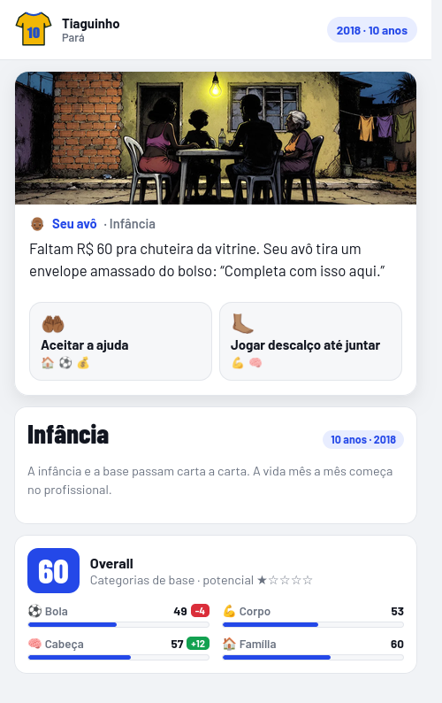
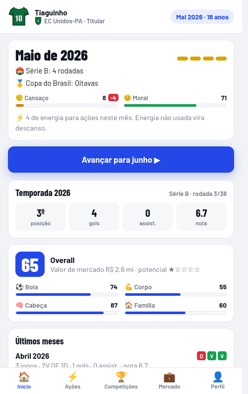
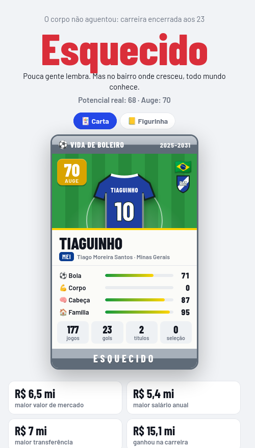

# Vida de Boleiro

Jogo de navegador sobre a carreira de um jogador de futebol, da rua aos 7 anos até a aposentadoria, um mês de cada vez.
Você escolhe o que treinar, que proposta aceitar e o que fazer fora de campo; as chances aparecem na tela, e o mais comum é terminar Flopado ou Esquecido.

**[▶ Jogar no GitHub Pages](https://lcsmll.github.io/vida-de-boleiro/)**

<p align="center"></p>

| Prólogo | Temporada | Fim de carreira |
|---|---|---|
|  |  |  |

## Como funciona

- **Prólogo em cartas** (7 a 16 anos): rua, escola, peneira e base. O profissional começa aos 17.
- **Turnos mensais** com calendário real a partir da data de nascimento. Brasil, Argentina, EUA e Japão jogam de janeiro a dezembro; Europa e Arábia, de agosto a maio. Janelas de transferência em janeiro e julho.
- **Ações com probabilidade visível**, que muda conforme os atributos. A energia limita quantas você faz por mês.
- **Sete posições**, cada uma com pesos próprios no overall. Defensores contam desarmes e jogos sem sofrer gol; o goleiro conta defesas e envelhece mais tarde.
- **Clubes fictícios** por padrão, com um editor para usar nomes reais (salvo só no seu navegador). Seleções usam países reais.
- Funciona no celular, em modo claro e escuro, e salva o jogo no navegador.

## Como foi feito

- **[Claude](https://claude.ai)**: desenho do jogo, regras, textos das cartas e balanceamento.
- **[Claude Code](https://claude.com/claude-code)**: separou o HTML único original (~160 KB) em módulos ES sem bundler, escreveu os robôs de teste (Selenium) que jogam centenas de carreiras para medir o balanceamento e publicou no GitHub Pages.
- **[Higgsfield](https://higgsfield.ai) via MCP**: as ilustrações das cenas, geradas de dentro do Claude Code com um prompt de estilo único (nanquim grosso, cores chapadas, textura de serigrafia) e uma imagem de referência para manter o mesmo traço em todas.

Tecnicamente é HTML, CSS e JavaScript puros: nada para instalar nem compilar. Para rodar localmente:

```bash
python3 -m http.server 8765
# abra http://localhost:8765
```

Por usar módulos ES, abrir o `index.html` direto do disco não funciona; precisa de um servidor HTTP.

## O que aprendi

- **Balancear um jogo exige medir.** A primeira versão parecia difícil, mas um robô jogando dezenas de carreiras por posição mostrou que mais da metade terminava em "o corpo não aguentou" e que a mesma carta aparecia até 10 vezes. Sem o simulador eu não teria visto.
- **Limites explícitos deixam a história variada.** Dar a cada evento um número máximo de aparições e um intervalo mínimo resolveu a repetição melhor do que mexer em pesos.
- **Dá para ir longe sem framework.** Módulos ES nativos bastaram para organizar um jogo de ~1.500 linhas, e o deploy é só um push.
- **Arte com IA precisa de regras fechadas.** Um prompt-base fixo, uma imagem de referência e regras como "o protagonista nunca mostra o rosto" foram o que manteve as cenas com cara de pacote único.
- **Escrever as decisões de design em um arquivo** (o que não muda sem conversar) evitou que cada sessão de ajuste desfizesse a anterior.

## Roadmap

- [ ] Ilustrações das 9 cenas novas (técnico, empresário, torcida, bebê, peneira, pênalti, aposentadoria, academia, defesa). Até lá, cada uma mostra a ilustração mais parecida.
- [ ] Ajuste fino do balanceamento por posição (meta: Lenda rara em todas, inclusive goleiro e zagueiro).
- [ ] Conquistas e um "hall da fama" das suas carreiras anteriores.
- [ ] Compartilhar a ficha final como imagem direto no celular.
- [ ] Mais ligas e competições continentais.
- [ ] Modo técnico depois da aposentadoria.

As mudanças de cada versão estão no [CHANGELOG](CHANGELOG.md).
